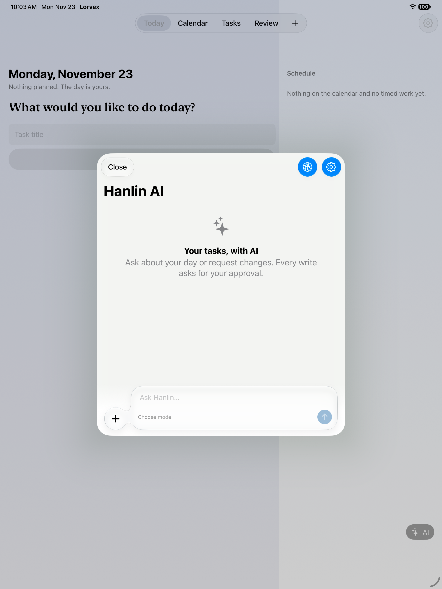
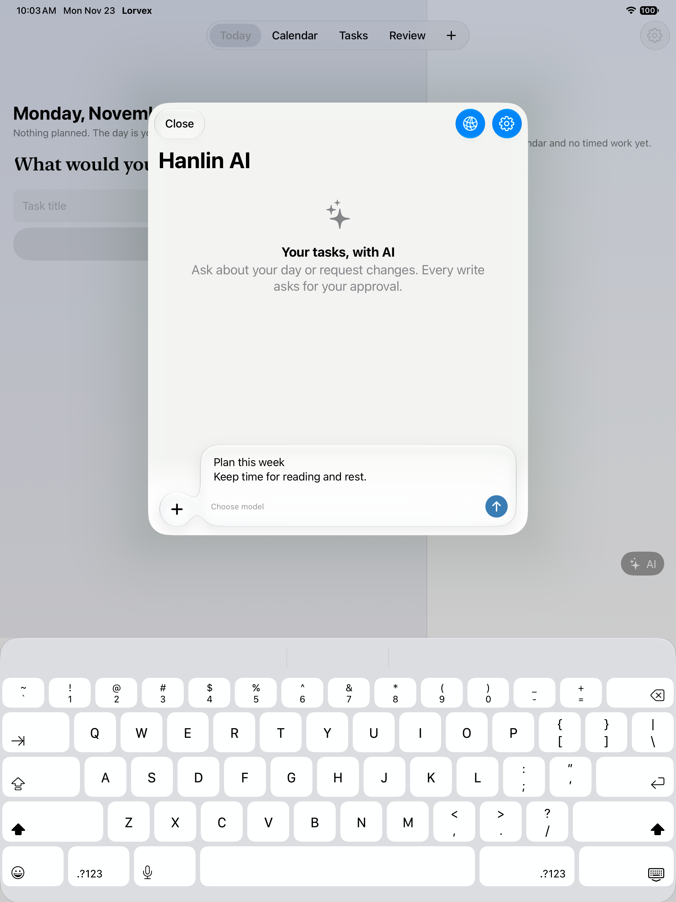
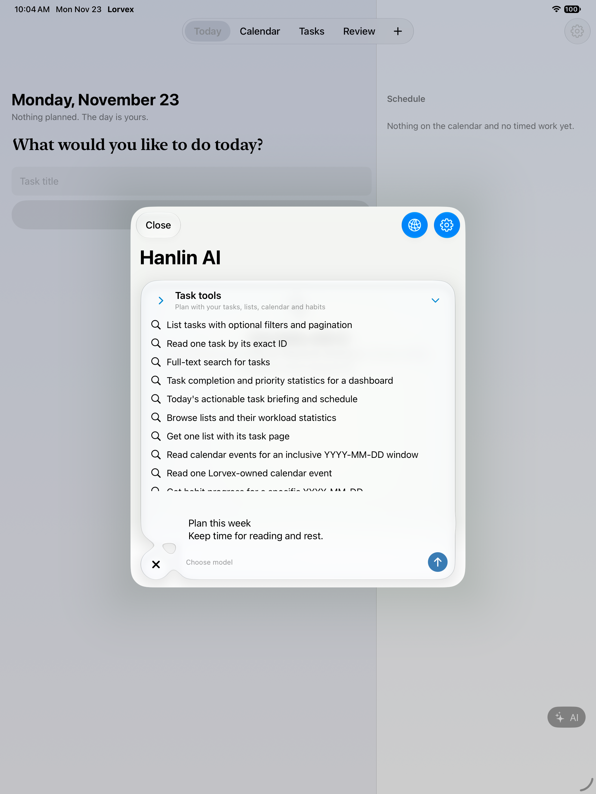

# Lorvex original Hanlin UI — native acceptance, 23 November 2026

The original UI test passed inside the real Lorvex iPad app after the shared live-draft ownership repair. The unchanged test executed once, with **1 passed, 0 failures, 74.620 seconds**. All four original XCTest screenshots were inspected and are retained below.

## Exact accepted source and runtime

| Item | Recorded value |
| --- | --- |
| Native run | [45148401438](https://github.com/davidpovarsky/lorvex/actions/runs/45148401438) — SUCCESS |
| Consumer source | `2e6a5e202262250281b55f2c6418dc1737c7b65f` |
| Canonical SDK | `0dae98f7b44b3cb4ee4d8dacd1913f2ed317a965` |
| Native job | `137603310142`, 09:35:35–10:05:12 UTC, 29m37s |
| Toolchain | Xcode 27.2 (27B52), iOS SDK/runtime 27.2 (24B8117) |
| Actual simulator | iPad Pro 13-inch (M4), `iPad-Pro-13-inch-M4-8GB` |
| Original selector | `LorvexMobileUITests/HanlinSDKIntegrationTests/testOriginalComposerInsideLorvex` |
| Scope | `validation_scope=ui`; Agent tests and device export skipped deliberately |

The fresh run compiled and launched the repaired simulator app. Both exact workflow source guards passed: the complete host-source inventory allows only the three reviewed draft adapters, and the installed canonical SDK contains the original 534 unchanged source/resource entries plus the one original `HanlinComposerDraft` file. The generated manifest is unchanged. The canonical installer and resource profile were verified on the Apple runner, with zero binary targets.

The successful selector opened the actual assistant, used the original native multiline editor, typed the original two-line text, verified Send became enabled, opened the original Morph panel and real Lorvex tool catalog, closed the panel and verified the draft, then dismissed/reopened the assistant and verified the editor remained hittable. Its assertions and timeouts were unchanged. It did not send a paid/live provider request.

## Corrected observed defect

[The preceding native run 45133684085](https://github.com/davidpovarsky/lorvex/actions/runs/45133684085) showed the initial `P` at the end of the draft before Morph opened. That was a typing/caret ordering defect; panel closure was not established as its cause. The host now retains the original shared `HanlinComposerDraft` and the Binding and synchronous snapshot reader address that same owner. The original class implementation, atomic text/revision update, stable owner identity, native editor algorithm, layout and animation remain unchanged. See [the source repair receipt](HANLIN_DRAFT_UI_REPAIR_20261123.md) and its complete [source inventory](HANLIN_DRAFT_UI_REPAIR_20261123.json).

The new native draft capture reads exactly:

```text
Plan this week
Keep time for reading and rest.
```

The same text remains visible in the expanded Morph panel. The original close-panel draft assertion then passed. The final reopened screen intentionally has a new empty draft; no persistence claim is made for an unsent draft across full assistant dismissal.

## Original native screenshots

### Original Composer

The actual Lorvex task workspace surrounds the Hanlin assistant. The original empty Composer, native entry surface, model control and disabled Send control are visible.



SHA-256: `a9ee5d5275c8c4aa96f63944e08f537279a23ae725ac0bf3348360e6dd5ae21a`.

### Native multiline draft

The native iPad keyboard is visible. Both lines read exactly Plan this week / Keep time for reading and rest. The initial P remains at the beginning and Send is enabled. The reported text-order defect is absent in this capture.



SHA-256: `3c2128e11370da0407ac8da82d46261a1401a1b1f3fc6082929cfcdc52e1cf32`.

### Original Morph panel and real host tools

The original expanded Morph panel shows the real Lorvex task/list/calendar tool catalog. The same complete multiline draft remains visible below the scrollable tool list.



SHA-256: `20e4fc8bf2c29f1dad1aa5ab67ee22e986cd1bb5418ae70c4fcf103f795e29b4`.

### Reopened actual assistant

The actual assistant was closed and reopened. The original empty Composer is visible and the unchanged XCTest confirmed the native editor is hittable. This does not claim persistence of an unsent draft across dismissal.


SHA-256: `5cacb8bf0a652a084cd5fc0d0efe76e882de55df4c27f3acc746bccfc42f215c`.

## Evidence and reuse boundaries

The complete GitHub evidence artifact is **14806473186**, **8,620,741 bytes**, SHA-256 `6a6732ca29d962c6832e319aed63ad4a36d57a2fb05f9347e1f3c24e37efcc32`. Its download digest was verified. It contains the original xcresult, exported screenshots, native test log, actual simulator inventories and installed SDK receipt. The retained full job log is 9,497,800 bytes, SHA-256 `597be9263a7dde4739d87c75742551e62a111dd5950729e03a9553d9309f804d`. [The machine-readable acceptance receipt](HANLIN_UI_ACCEPTANCE_20261123.json) records source objects, attachment metadata, visual observations and exact provenance.

The six native Agent cases remain attributed to run 45119218473 / consumer 09307ef3 / SDK d49. The five earlier presentation-state cases retain their separate [source-bound reuse receipt](HANLIN_SDK_STATE_REUSE_20261123.json). Neither suite was repeated. The successful unsigned arm64 device export remains evidence for the original 09307 binary only: this UI continuation did not build/export a repaired-current device IPA, and the original IPA was not uploaded. [The original acceptance record](HANLIN_NATIVE_ACCEPTANCE_20261123.json) is preserved unchanged.

This closes the actual original-UI defect and its scoped simulator acceptance. Physical-device installation, signed distribution, live provider execution and OAuth pairing were not performed by this selector. Later SDK commits are excluded from the exact 0dae claim unless separately compared and accepted. No further workflow was dispatched to write this documentation.
